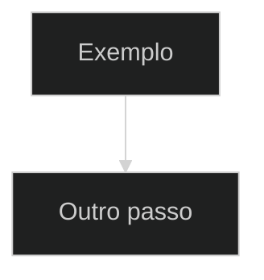

# Make Plan

Transforme contexto técnico existente em um plano de implementação completo, executável por outro agente sem reabrir as decisões fundamentais.

Esta skill planeja. Ela não implementa o plano durante a mesma invocação.

## Contrato de execução

Ao usar esta skill:

- leia integralmente o contexto indicado pelo usuário;
- procure e use o `reference-analysis.md`, discovery, ADR, issue ou notas da iniciativa quando existirem;
- audite código, testes, callers, configuração, docs e comandos reais antes de afirmar detalhes;
- feche decisões sempre que a evidência permitir;
- transforme limitações atuais em pré-requisitos habilitadores, não em cortes silenciosos;
- produza um arquivo Markdown completo em `.notes`;
- não implemente código ou docs;
- não execute os marcos;
- não crie commit ou push durante a criação do plano;
- não crie nem troque de branch.

O plano gerado deve, por padrão, exigir durante sua execução futura:

- trabalho direto na `main`;
- `make ci-fast` durante desenvolvimento/checkpoints e no fechamento de cada marco;
- `make ci-full` somente no fechamento do plano inteiro;
- commit semântico local próprio ao final de cada marco validado;
- nenhum push sem pedido explícito do usuário.

Se o usuário substituir explicitamente alguma dessas regras, registre a exceção no plano.

## Entradas aceitas

- análise criada pela skill `make-analysis`;
- discovery;
- estudo técnico;
- issue ou especificação;
- proposta de funcionalidade;
- auditoria ou review;
- ADR;
- conversa/contexto textual;
- anotações soltas;
- plano existente que precise ser refeito ou detalhado.

Se o contexto apontar uma iniciativa existente, preserve seu slug e sua pasta. Não crie uma iniciativa paralela para o mesmo trabalho.

## Destino mensal obrigatório

A entrega principal deve ser:

```text
.notes/{YYYY-MM}/{DD}-{slug-curto-da-iniciativa}/implementation-plan.md
```

Regras de resolução:

1. Use o mês e o dia de criação da iniciativa no fuso local: `YYYY-MM` na pasta do mês e `DD-` como prefixo do slug.
2. Procure primeiro uma iniciativa existente pelo caminho fornecido, pelo slug e pelo tema.
3. Quando houver `reference-analysis.md`, salve o plano na mesma pasta da análise.
4. Reutilize a pasta existente mesmo que o trabalho continue em outro mês.
5. Não mova iniciativas antigas que usem qualquer convenção anterior; se o plano pertence a uma delas, mantenha o caminho existente.
6. Para iniciativas novas, use somente `.notes/{YYYY-MM}/{DD}-{slug}/`.
7. Se `{DD}-{slug}` já existir no mesmo mês para outra iniciativa, acrescente `{DD}-{slug}-02`, `{DD}-{slug}-03` e assim por diante.
8. Nunca versione `.notes`.

Arquivos auxiliares opcionais:

```text
.notes/{YYYY-MM}/{DD}-{slug-curto-da-iniciativa}/discovery.md
.notes/{YYYY-MM}/{DD}-{slug-curto-da-iniciativa}/decisions.md
.notes/{YYYY-MM}/{DD}-{slug-curto-da-iniciativa}/validation.md
.notes/{YYYY-MM}/{DD}-{slug-curto-da-iniciativa}/follow-up.md
```

Crie apenas os arquivos necessários. O `implementation-plan.md` é sempre o checklist vivo e a fonte de execução.

## Missão do plano

O plano deve:

- dividir a implementação em marcos claros e bloqueantes;
- conter tarefas pequenas, objetivas e rastreáveis;
- usar IDs WBS estáveis;
- definir DoD por marco;
- definir testes técnicos e comportamentais;
- indicar validações manuais e operacionais;
- prever CLI, service, API e frontend quando impactados;
- avaliar e planejar atualizações de `docs/`;
- explicitar riscos, dependências, decisões e premissas;
- fechar ou encaminhar todo ponto em aberto;
- sugerir um commit semântico local por marco;
- manter change surface controlada sem subresolver o objetivo;
- permitir execução incremental segura por outro agente.

## Workflow obrigatório

### 1. Resolver iniciativa e contexto

- identifique o objetivo real do usuário;
- encontre a pasta existente da iniciativa;
- leia integralmente os artefatos relevantes;
- extraia recomendações, decisões, pontos em aberto, limites e estado-alvo;
- registre quais materiais de entrada governam o plano.

### 2. Auditar o código atual

O código do repositório é a fonte principal de verdade sobre o estado atual.

Inspecione, quando aplicável:

- estrutura de diretórios e ownership;
- tipos, contratos, interfaces e boundaries;
- callers e fluxo runtime;
- stores, schema e persistência;
- config, defaults, render e validação;
- CLI e contratos de saída;
- API, rotas e DTOs;
- service local, instalação e lifecycle;
- frontend, estado, navegação e integração visível;
- testes, fixtures e golden sets;
- Makefile/scripts/workflows de CI;
- `docs/` e diagramas existentes;
- histórico/convenções de commits.

Não invente paths, comandos, flags, campos ou comportamento. Quando houver dúvida:

1. procure no código;
2. procure nos testes;
3. procure em docs/ADR/notas;
4. trace callers/runtime;
5. se ainda faltar evidência, use `A confirmar` e dê um caminho sugerido.

Se `docs/` divergir do código, trate o código como verdade do estado atual e planeje a reconciliação documental.

### 3. Fechar o estado-alvo

Compare explicitamente estado atual e estado-alvo antes dos marcos.

Quando a arquitetura atual não comportar a solução de qualidade:

- identifique a limitação;
- defina o pré-requisito habilitador;
- explique o ganho de clareza, correção, segurança ou manutenção;
- registre o risco de pular o habilitador;
- transforme-o em marco inicial ou tarefa bloqueante;
- identifique os marcos dependentes.

Não reduza o objetivo para caber no código atual.

### 4. Fechar decisões e pontos em aberto

Registre decisões arquiteturais e comportamentais de forma inequívoca.

Para cada ponto realmente aberto, inclua:

- **Pergunta:** o que falta decidir ou descobrir;
- **Impacto:** o que muda dependendo da resposta;
- **Caminho sugerido:** recomendação ou investigação concreta;
- **Base da sugestão:** código, teste, docs, referência externa ou premissa.

Não deixe pergunta sem encaminhamento. Se a evidência já permite decidir, feche a decisão no plano em vez de manter uma falsa dúvida.

### 5. Avaliar `docs/`

Planeje atualização de `docs/` quando a iniciativa alterar:

- capacidade ou regra de domínio;
- fluxo de uso, instalação ou operação local;
- configuração;
- estrutura de dados relevante ao usuário/operador;
- CLI, API ou service;
- UI, navegação ou experiência visível;
- arquitetura de alto nível;
- diagramas.

Liste arquivos reais a criar/revisar e o conteúdo esperado. Faça a atualização preferencialmente no final do marco que estabiliza o comportamento.

Não replique detalhes mecânicos de structs/tabelas em docs sem necessidade pública.

Se um marco não impactar docs, escreva explicitamente:

```markdown
Atualização de docs/: não aplicável neste marco.
```

Quando o projeto usar Docsify escuro, exija Mermaid com:



### 6. Definir estratégia e ordem

- ordene habilitadores antes das features dependentes;
- evite marcos que deixem callers/surfaces em contrato impossível;
- garanta que cada marco possa compilar, ser testado e ser commitado sozinho;
- não antecipe feature futura com stub produtivo, toggle temporário ou API paralela;
- use replacement/hard cut por padrão;
- não planeje compatibility shim, migration ou fallback legado sem pedido explícito;
- registre dependências entre marcos/tarefas;
- não acumule validação crítica apenas no marco final.

### 7. Construir marcos WBS

IDs permitidos dentro de marcos:

- `M01`, `M02`, ... para marcos;
- `M01.TAR01`, `M01.TAR02`, ... para tarefas;
- `M01.VAL01`, `M01.VAL02`, ... para validações;
- `M01.FEC01`, `M01.FEC02`, ... para fechamento;
- `M01.DOD01`, `M01.DOD02`, ... para DoD.

Regras:

- todo checkbox dentro de um marco começa com ID;
- IDs seguem a ordem esperada de execução;
- IDs não se repetem;
- não renumere itens já executados ao atualizar um plano;
- não use subtarefas; divida itens grandes em novas tarefas sequenciais;
- tarefas de docs são `TAR`; confirmação de não aplicável é `VAL`;
- testes técnicos, comportamentais e manuais são `VAL`;
- dependências usam `Depende de: <id>`;
- use IDs apenas dentro dos marcos;
- a validação final integrada usa checkboxes simples, sem IDs.

Cada tarefa deve:

- ser objetiva e pequena;
- indicar arquivo, módulo, contrato, comando ou comportamento quando conhecido;
- ter conclusão verificável;
- evitar verbos vagos sem resultado explícito;
- remover o caminho antigo no mesmo marco quando houver hard cut.

### 8. Definir validações

Durante cada marco, inclua:

- testes unitários e de contrato relevantes;
- testes de integração/persistência quando aplicáveis;
- `make ci-fast`;
- comportamento em formato “Dado/Quando/Então”;
- CLI/API/service/frontend conforme impacto;
- docs atualizados ou confirmação de não aplicável.

Ao final de todo marco, inclua obrigatoriamente:

- revisão do diff;
- atualização do próprio `implementation-plan.md`;
- `make ci-fast` no estado final do marco, como único gate de CI do fechamento;
- `git status --short`;
- commit semântico local;
- confirmação de que o commit existe antes do próximo marco.

O gate final único de CI completo é `make ci-full`, somente após todos os marcos, no fechamento do plano inteiro. Essa cadência preserva os testes específicos, a cobertura, os critérios de aceite e as evidências exigidas em cada marco.

Não invente comandos. Consulte Makefile, scripts e docs do projeto.

### 9. CLI e service local

Quando aplicável, o plano deve dizer como:

- instalar/atualizar o binário pelo fluxo real do projeto;
- iniciar, parar ou reiniciar o service;
- verificar status e logs;
- executar comandos/flags impactados;
- testar integração CLI + daemon;
- validar API/estado/banco/arquivos locais;
- limpar ou recriar estado local com alvo explícito e seguro.

Se banco local for efêmero, hard reset é aceitável. Não planeje migração formal, preservação ou rollback complexo sem requisito explícito de produção/compatibilidade.

### 10. Frontend e `agent-browser`

Quando a mudança impactar UI, navegação, estado visual, UX ou integração visível, inclua validação com `agent-browser` para:

- abrir a aplicação real;
- navegar pelo fluxo;
- validar happy path, loading, empty e error states;
- validar mensagens e persistência após reload;
- validar interação, foco/teclado e responsividade quando relevantes;
- capturar evidência sem expor dados sensíveis.

Não substitua essa validação por testes unitários, `curl` ou inspeção manual. Essas validações podem complementar, não substituir.

Quando não aplicável, registre:

```markdown
Validação com agent-browser: não aplicável neste marco.
```

### 11. Commits da execução futura

Cada marco concluído deve sugerir um commit Conventional Commits local.

Regras do plano:

- branch `main`;
- commit somente depois das validações específicas e `make ci-fast` verdes no estado final do marco;
- um marco por commit;
- atualizar checkboxes antes do commit;
- revisar diff/status;
- stage apenas arquivos versionados do marco;
- nunca incluir `.notes`;
- não iniciar o marco seguinte antes do commit;
- não fazer push sem autorização explícita.

A invocação de `make-plan` não cria esses commits; ela apenas registra a política para a execução futura.

### 12. Validar o próprio plano

Antes de entregar:

- confirme que todos os paths/comandos citados existem ou estão marcados `A confirmar`;
- confira que callers e runtime críticos foram auditados;
- confirme que decisões não se contradizem entre seções/marcos;
- valide que nenhum marco depende de feature futura ainda inexistente;
- valide que cada marco tem tarefas, validações, fechamento, DoD e commit;
- confirme `make ci-fast` durante desenvolvimento/checkpoints e no fechamento de cada marco, e `make ci-full` somente no fechamento do plano inteiro;
- confirme CLI/service/frontend/docs como aplicáveis ou explicitamente não aplicáveis;
- procure IDs duplicados e fora de ordem;
- confira que a validação final não usa IDs;
- revise `git status --short`;
- confirme que somente arquivos de planejamento foram criados e que nenhum commit/push ocorreu.

## Formato obrigatório do plano

O documento deve começar exatamente com:

```markdown
# Plano de Implementação — <nome curto da iniciativa>
```

Use esta estrutura mínima, sem remover seções:

```markdown
# Plano de Implementação — <nome curto da iniciativa>

> Destino: `.notes/{YYYY-MM}/{DD}-{slug-curto-da-iniciativa}/implementation-plan.md`

## 1. Resumo Executivo

## 2. Contexto de Entrada

## 3. Objetivos

## 4. Fora de Escopo

## 5. Premissas

## 6. Código como Fonte da Verdade

## 7. Estado-Alvo e Pré-requisitos Habilitadores

## 8. Impacto em docs/

## 9. Pontos em Aberto e Caminhos Sugeridos

## 10. Estrutura de Arquivos do Plano

## 11. Estratégia de Implementação

## 12. Marcos de Implementação

### M01 — <nome do marco>

#### Objetivo

#### Tarefas

- [ ] M01.TAR01 — ...
- [ ] M01.TAR02 — ...

#### Validações

- [ ] M01.VAL01 — Executar testes técnicos relevantes.
- [ ] M01.VAL02 — Dado <estado>, quando <ação>, então <resultado>.
- [ ] M01.VAL03 — Executar `make ci-fast`.
- [ ] M01.VAL04 — Validar CLI/service/frontend/docs ou marcar cada item como não aplicável.

#### Fechamento do marco

- [ ] M01.FEC01 — Revisar o diff do marco e confirmar que está limitado ao escopo planejado.
- [ ] M01.FEC02 — Atualizar este `implementation-plan.md` com o status real do marco.
- [ ] M01.FEC03 — Executar `make ci-fast` no estado final do marco, como único gate de CI do fechamento.
- [ ] M01.FEC04 — Revisar `git status --short`.
- [ ] M01.FEC05 — Criar um commit semântico local com as alterações versionadas do marco.
- [ ] M01.FEC06 — Confirmar o commit antes de iniciar o próximo marco.

#### Definition of Done

- [ ] M01.DOD01 — Comportamento/decisão do marco concluído.
- [ ] M01.DOD02 — Testes e `make ci-fast` passaram.
- [ ] M01.DOD03 — `make ci-fast` passou no estado final do marco, com evidência registrada.
- [ ] M01.DOD04 — CLI/service/frontend/docs validados ou marcados não aplicáveis.
- [ ] M01.DOD05 — Plano, diff e status revisados.
- [ ] M01.DOD06 — Commit local do marco criado antes do próximo marco.

#### Commit obrigatório do marco

Mensagem sugerida:

```text
<tipo>(<escopo>): <mensagem>
```

Regra: não acumular dois ou mais marcos no mesmo commit.

## 13. Validação Final Integrada

- [ ] Revisar arquivos alterados.
- [ ] Conferir os recibos de `make ci-fast` e dos testes específicos de todos os marcos.
- [ ] Instalar/reiniciar/validar service local, se aplicável.
- [ ] Validar CLI e API, se aplicável.
- [ ] Validar frontend com `agent-browser`, se aplicável.
- [ ] Revisar `docs/` e Mermaid, se aplicável.
- [ ] Executar `make ci-full` somente no fechamento do plano inteiro, sobre o estado final integrado, e registrar a aprovação antes de declarar o plano concluído.
- [ ] Revisar `validation.md` e `follow-up.md`, se existirem.
- [ ] Garantir que os checkboxes refletem o estado real.
- [ ] Garantir um commit local próprio por marco antes do seguinte.
- [ ] Confirmar que não houve push sem autorização.

## 14. Checklist Final

## 15. Notas para Follow-up
```

Seções extras são permitidas quando eliminarem ambiguidade, por exemplo:

- decisões fechadas;
- contratos de estado-alvo;
- diagrama de dependências;
- estratégia de teste;
- hard cut/estado local;
- matriz de rastreabilidade.

## DoD mínimo por marco

Todo marco deve comprovar:

- comportamento ou decisão concluída;
- testes adicionados/atualizados;
- testes técnicos e comportamentais executados;
- `make ci-fast` durante desenvolvimento/checkpoints;
- `make ci-fast` no fechamento do marco, sobre seu estado final;
- CLI validado quando aplicável;
- service instalado/reiniciado/validado quando aplicável;
- frontend validado com `agent-browser` quando aplicável;
- impacto em `docs/` revisado e conteúdo atualizado quando aplicável;
- `implementation-plan.md` atualizado antes do commit;
- diff e `git status --short` revisados;
- commit semântico local na `main`;
- nenhum marco posterior iniciado antes desse commit.

O plano inteiro só conclui depois de `make ci-full` passar no estado final integrado, além dos critérios específicos de todos os marcos.

## Fora de escopo padrão

Salvo pedido explícito, mantenha fora:

- deploy e release;
- rollback formal;
- observabilidade/plano operacional de produção;
- migração retrocompatível de banco local;
- suporte a versões antigas;
- compatibility shims/fallbacks legados;
- branch nova;
- push/PR;
- compatibilidade com usuários externos não mencionados.

`docs/` não é fora de escopo quando domínio, produto, arquitetura, uso, instalação, config, CLI, service, API, frontend ou diagramas mudarem.

## Resposta final

Depois de salvar e auditar o plano, responda de forma concisa com:

- caminho do `implementation-plan.md`;
- objetivo e estado-alvo resumidos;
- marcos criados;
- decisões e cortes de escopo centrais;
- pré-requisitos habilitadores;
- validações previstas;
- pontos realmente abertos, se houver;
- confirmação de que nenhum código, docs, commit, push ou branch foi alterado.
